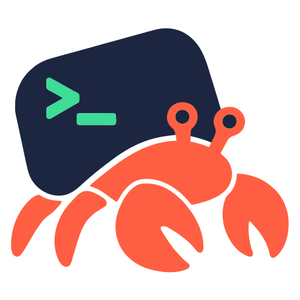

<p align="center">
  
</p>

<h1 align="center">Crabex</h1>

<p align="center"><strong>Any model, living in Codex's shell.</strong><br>
Keep your ChatGPT login, route every turn, see every token.</p>

---

Crabex is a local proxy that sits between [Codex](https://github.com/openai/codex)
(CLI and Desktop) and its backend. Codex keeps working exactly as it does today:
your ChatGPT subscription login, the `/model` picker, native subagents, Apps,
WebSockets. Crabex lets you put **other models inside that shell**, and shows you
precisely what Codex sends to them.

Like a hermit crab, the model moves in; the shell stays the same.

## Why

Most "use other models with Codex" setups replace Codex's provider with an API key
and lose what makes the harness good. Crabex takes the opposite approach:

- **No new login.** It forwards your existing Codex OAuth session to
  `chatgpt.com`. No API key, no CLIProxyAPI. Routed models use their own tokens.
- **Native, not bolted on.** Routed models appear in Codex's own model picker,
  can be spawned as native subagents, and keep tool calls, compaction, and
  reasoning working across providers.
- **Glass box.** Every request chain is captured locally, so you can see which
  instructions, tools, and history consume your context, then trim them.

## What it does

|     | Capability                     | Details                                                                                                                                                                                                                                               |
| --- | ------------------------------ | ----------------------------------------------------------------------------------------------------------------------------------------------------------------------------------------------------------------------------------------------------- |
| 🔀  | **Model routing**              | Map any Codex model slug to an OpenAI-compatible Responses gateway or a native **Anthropic Messages** API (including Bedrock Mantle). HTTP/SSE and WebSocket on both sides. [Anthropic routes](docs/anthropic-routes.md)                              |
| 📋  | **Model picker integration**   | Routed models are injected into Codex's `/models` catalog with display names, descriptions, ordering, and metadata copied from a template model. [Catalog refresh](docs/refresh-model-catalog.md)                                                     |
| 🛟  | **Failover and flex**          | Ordered fallback targets with retry, backoff, and circuit breakers. Advertise `-flex` slugs for half-price OpenAI flex processing that falls back to standard. [Flex routes](docs/flex-routes.md)                                                     |
| 🧑‍🤝‍🧑  | **Subagents across providers** | Spawn routed models as Codex subagents, see which routes hold native spawn slots, and safely mix provider histories in forks and child agents. [Tool compatibility](docs/codex-tool-compatibility.md)                                                 |
| 🧰  | **Tool compatibility**         | Per-route tool policy: pass, translate, broker, omit, or reject each tool type. Freeform `apply_patch`, `tool_search`, and web search keep working on models that don't support them natively. [Tool compatibility](docs/codex-tool-compatibility.md) |
| 🔍  | **Context inspector**          | Captures every request chain and breaks it into context parts, sections, tools, and token estimates, per model, harness, and project. [Captures](docs/captures.md) · [Design](docs/context-inspector.md)                                              |
| ✂️  | **Transformations**            | Rules that delete context parts, rewrite text, or disable tools before a request leaves your machine, with hit/miss telemetry and on-demand preview. [Inspector](docs/context-inspector.md)                                                           |
| 🔌  | **Apps relay**                 | Keeps Slack, Drive, and other ChatGPT Apps working when Codex's ChatGPT base URL points at the proxy. [Apps relay](docs/apps-auth-relay.md)                                                                                                           |
| ⚙️  | **Config-bundle overrides**    | Answer Codex's remote config-bundle fetch with your own edited bundle, from the **Advanced** page.                                                                                                                                                    |
| 📈  | **Live traffic and stats**     | Watch in-flight requests, routing attempts, fallbacks, cache use, and flex vs. standard serves.                                                                                                                                                       |
| 🍎  | **macOS service**              | One command installs a LaunchAgent with its own runtime, local HTTPS with Keychain trust, safe restarts, and automatic rollback. [macOS service](docs/macos-service.md)                                                                               |

Everything is configured from the web UI served on the proxy's own port, or
from plain JSON files under `.crabex/`.

## How it works

```text
 Codex CLI / Desktop                     Crabex (127.0.0.1:8765)                     Upstreams
┌──────────────────┐   Responses API   ┌───────────────────────────────┐   OAuth   ┌──────────────────┐
│ /model picker    │ ────────────────▶ │ capture ─▶ transform ─▶ route │ ────────▶ │ chatgpt.com      │
│ subagents, tools │   HTTP / WS       │                               │ ────────▶ │ Responses gateway│
│ Apps (MCP)       │ ◀──────────────── │ UI + local API on same port   │ ────────▶ │ Anthropic API    │
└──────────────────┘                   └───────────────────────────────┘           └──────────────────┘
```

Unrouted models go to `chatgpt.com` with your login, unchanged except for any
transformations you enable. Routed models are translated to the target API and
back, so Codex never knows the difference.

## Quick start

Requirements: [Vite+](https://viteplus.dev) (`vp`, which provides Bun) and a
working Codex login. The proxy runs anywhere Bun does; the background service is
macOS-only.

```sh
vp install
vp run build
./packages/proxy/dist/cli.mjs proxy
```

Open <http://127.0.0.1:8765>. On the **Codex setup** page, turn on both endpoint
toggles. Or add them to `~/.codex/config.toml` yourself:

```toml
openai_base_url = "http://127.0.0.1:8765/backend-api/codex"
chatgpt_base_url = "http://127.0.0.1:8765/backend-api"
```

Prefer to opt in per session? Put those lines in `~/.codex/crabex.config.toml`
and run `codex --profile crabex`.

Then run Codex as usual. Captures show up live in the UI. Add a route on the
**Model routes** page and the new model appears in Codex's `/model` picker.

To keep Crabex running across reboots (and use the ChatGPT desktop app, which
requires HTTPS):

```sh
./packages/proxy/dist/cli.mjs service install --https
```

## Configuration

All state lives in `.crabex/` relative to where you start the proxy (the macOS
service keeps its own copy under `~/Library/Application Support/crabex/data`).
Keep private route configuration there rather than in a repository.

| File                                         | Purpose                                                                                     |
| -------------------------------------------- | ------------------------------------------------------------------------------------------- |
| `model-routes.json`                          | Routes, targets, tool policies, picker metadata                                             |
| `transformations.json`                       | Context transformation rules                                                                |
| `config.json`                                | Proxy settings (Apps relay, routed agents, search broker)                                   |
| `config-bundle.json`                         | Config-bundle override                                                                      |
| `captures/`                                  | NDJSON request captures, kept for 7 days or 2 GiB ([retention](docs/captures.md#retention)) |
| `stats.json`                                 | Route counters and a daily per-model token ledger, kept indefinitely                        |
| `upstream-cache.json`, `snapshot-cache.json` | Caches                                                                                      |

Every path can be overridden with a flag; run `crabex --help` for the full list.

## CLI

```text
crabex proxy [--listen 127.0.0.1:8765] [--upstream https://chatgpt.com] [--project <key>] ...
crabex service install [--https] [--env NAME]... [-- proxy options]
crabex service uninstall|status|restart|logs
crabex service tls status|renew|remove
```

## Documentation

- [Anthropic Messages routes](docs/anthropic-routes.md): Claude via Anthropic or Bedrock Mantle
- [Flex routes](docs/flex-routes.md): half-price flex processing with fallback
- [Codex tool compatibility](docs/codex-tool-compatibility.md): tool policies, search, subagent handoff
- [Captures and Probes](docs/captures.md): what is recorded and how to inspect it
- [Context inspector design](docs/context-inspector.md) and [domain language](CONTEXT.md)
- [Apps authentication relay](docs/apps-auth-relay.md): keeping ChatGPT Apps working
- [macOS service](docs/macos-service.md): LaunchAgent, HTTPS, updates
- [Refreshing the model catalog](docs/refresh-model-catalog.md)
- [Upgrading from agent-context-trimmer](docs/upgrading.md)

## Privacy and security

Crabex binds to loopback by default and is meant for a trusted, single-user
machine. Captures stay on disk with owner-only permissions and never include
headers. Your ChatGPT credentials are held in memory only; route tokens come from
environment variables you name. See the [Apps relay limitations](docs/apps-auth-relay.md)
before exposing the listener beyond localhost.

## Development

```sh
vp run dev     # build both packages and watch, single listener
vp check       # format, lint, type check
vp run test    # tests (Bun-native; not bare `vp test`)
vp run build
```

The repository holds `packages/proxy` (Bun server and CLI) and `packages/ui`
(React and Tailwind UI). `vp run dev:ui` runs a standalone Vite server for
frontend-only work.

## License

[MIT](LICENSE) © Bazyli Brzóska
